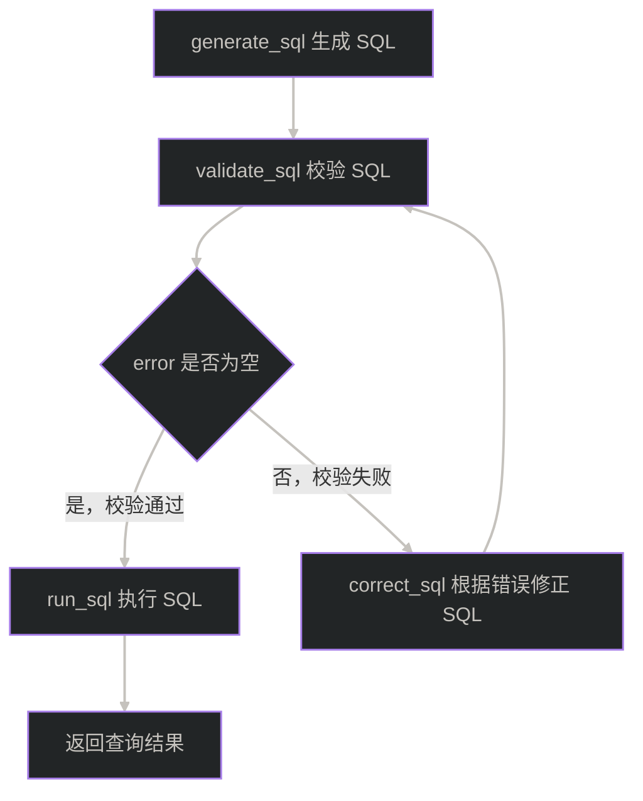

# 14 - 电商问数：SQL 生成与执行闭环

------

**本章课程目标：**

- 理解 SQL 生成前，智能体已经准备好了哪些上下文。
- 理解为什么生成 SQL 后不能马上执行，而要先用 `EXPLAIN` 做校验。
- 完成一次端到端测试，把问数智能体从自然语言问题跑到 SQL 查询结果。

**学习建议：** 这一章要看闭环，不要只看生成提示词。完整顺序是生成 SQL、校验 SQL、必要时校正、最后执行查询。重点留意条件分支如何决定走校正还是执行，以及错误信息怎样被带回给模型修正。跑通这条链路后，问数智能体才真正从“理解问题”走到“查出结果”。

**对应代码分支：** `14-agent-sql-loop`

------

## 1、本章在问数链路中的位置

前面几章已经完成了 SQL 生成前的准备工作：

```text
用户问题
  -> extract_keywords
  -> recall_column / recall_metric / recall_value
  -> merge_retrieved_info
  -> filter_table / filter_metric
  -> add_extra_context
```

到这里，智能体已经不再只有一句用户问题，而是拥有了一组相对完整的 SQL 生成上下文。

本章要完成最后四个节点：

```text
generate_sql  # 生成 SQL
validate_sql  # 校验 SQL
correct_sql   # 校正 SQL
run_sql       # 执行 SQL
```


------

## 2、SQL 生成前已经有什么

生成 SQL 之前，`state` 里最重要的是下面几类信息：

```text
query         # 用户原始问题
table_infos   # 可使用的表、字段、字段类型、字段描述、示例值
metric_infos  # 可参考的业务指标、指标口径、依赖字段
date_info     # 当前日期、星期、季度
db_info       # 当前数据库方言和版本
```

它们分别解决不同问题。

`query` 负责告诉模型“用户到底问了什么”：

```text
统计华北地区的销售总额
```

`table_infos` 负责告诉模型“数据库里有什么表、什么字段可以用”：

```yaml
- name: fact_order
  role: fact
  description: 订单事实表
  columns:
    - name: order_amount
      type: decimal
      role: measure
      description: 订单金额
- name: dim_region
  role: dimension
  description: 地区维度表
  columns:
    - name: region_name
      type: varchar
      role: dimension
      examples:
        - 华北
```

`metric_infos` 负责告诉模型“业务口径怎么算”：

```yaml
- name: GMV
  description: 所有订单成交金额总和
  relevant_columns:
    - fact_order.order_amount
  alias:
    - 销售总额
    - 成交额
```

`date_info` 和 `db_info` 则补充模型不能凭空确定的信息：

```yaml
date_info:
  date: "2026-04-27"
  weekday: "Monday"
  quarter: "Q2"

db_info:
  dialect: mysql
  version: 8.0.44
```

如果缺少这些上下文，模型也能写出一条“看起来像 SQL”的语句，但那条 SQL 很可能用错表、用错字段、写错指标口径，甚至不符合当前数据库版本。

所以本章的重点不是让模型自由发挥，而是让模型在前面整理好的约束范围内生成 SQL。

------

## 3、生成 SQL：generate_sql


`generate_sql` 的职责很单纯：**生成一条候选 SQL，并写入 `state["sql"]`。**

它不负责校验，也不负责执行。

### 3.1 提示词关注什么

项目对应提示词路径：`shopkeeper-agent/prompts/generate_sql.prompt`

这份提示词的核心输入有五个：

```text
table_infos
metric_infos
date_info
db_info
query
```

其中最关键的约束是：**输出必须只包含一条完整 SQL 语句的纯文本**。

需要注意的是，很多大模型在写代码时，会习惯性输出 Markdown 代码块：

~~~markdown
```sql
select ...
```
~~~

但项目拿到 SQL 后要直接交给数据库校验和执行。如果 SQL 字符串里混入 Markdown 代码块，数据库并不认识这些符号，就会报语法错误。

所以提示词必须明确要求：

```text
不要解释
不要 Markdown 代码块
不要 ```sql
只输出 SQL 本身
```

### 3.2 核心代码

项目对应文件路径：`shopkeeper-agent/app/agent/nodes/generate_sql.py`

```python
async def generate_sql(state: DataAgentState, runtime: Runtime[DataAgentContext]):
    writer = runtime.stream_writer
    writer("生成SQL")

    # 这些上下文都由前置节点准备完成，模型只在给定表、字段、指标口径范围内生成 SQL
    table_infos = state["table_infos"]
    metric_infos = state["metric_infos"]
    date_info = state["date_info"]
    db_info = state["db_info"]
    query = state["query"]

    prompt = PromptTemplate(
        template=load_prompt("generate_sql"),
        input_variables=["table_infos", "metric_infos", "date_info", "db_info", "query"],
    )

    # 生成 SQL 只需要一段纯文本，所以这里使用 StrOutputParser
    output_parser = StrOutputParser()
    chain = prompt | llm | output_parser

    result = await chain.ainvoke(
        {
            # YAML 更适合放进提示词：保留嵌套结构、顺序和中文说明，方便模型理解表字段关系
            "table_infos": yaml.dump(table_infos, allow_unicode=True, sort_keys=False),
            "metric_infos": yaml.dump(metric_infos, allow_unicode=True, sort_keys=False),
            "date_info": yaml.dump(date_info, allow_unicode=True, sort_keys=False),
            "db_info": yaml.dump(db_info, allow_unicode=True, sort_keys=False),
            "query": query,
        }
    )

    logger.info(f"生成的SQL：{result}")
    return {"sql": result}
```

这段代码里有两个点值得注意。

第一，结构化上下文会先转成 YAML：

```python
yaml.dump(table_infos, allow_unicode=True, sort_keys=False)
```

`allow_unicode=True` 可以保留中文，`sort_keys=False` 可以保留字段原始顺序。相比直接把 Python 对象转成字符串，YAML 更适合放进提示词。

第二，输出解析器使用的是 `StrOutputParser`，不是 `JsonOutputParser`。因为这一节点只需要一条 SQL 字符串，不需要 JSON 对象。

------

## 4、校验 SQL：validate_sql

生成 SQL 之后，不能直接执行。大模型即使拿到了上下文，也仍然可能出错。常见错误包括：

- 表名写错；
- 字段名写错；
- 字段别名写错；
- `join` 条件不完整；
- 聚合函数和 `group by` 不匹配；
- SQL 方言不符合当前数据库；
- 使用了提示词里没有提供的表或字段。

更稳的做法是：先让数据库帮我们检查这条 SQL 能不能解析，也就是执行：

```sql
explain <generated_sql>
```

`EXPLAIN` 原本是用来看 SQL 执行计划的，但这里主要利用它的副作用：**让数据库提前解析 SQL。**

如果 SQL 里有字段不存在，数据库会直接报错，例如：

```text
Unknown column 'd.region_name1' in 'where clause'
```

这条错误信息非常有用。后面 `correct_sql` 可以把它连同原 SQL 一起交给大模型，让模型做有依据的修正。

### 4.1 validate_sql 核心代码

项目对应文件路径：`shopkeeper-agent/app/agent/nodes/validate_sql.py`

```python
async def validate_sql(state: DataAgentState, runtime: Runtime[DataAgentContext]):
    writer = runtime.stream_writer
    writer("校验SQL")

    # 读取 generate_sql 写入状态的 SQL。
    sql = state["sql"]

    # SQL 可用性必须交给真实数仓判断，这里从运行时 context 中取 DW Repository。
    dw_mysql_repository: DWMySQLRepository = runtime.context["dw_mysql_repository"]

    try:
        # validate 内部使用 explain <sql>，只关心数据库能否成功解析这条 SQL。
        await dw_mysql_repository.validate(sql)
        logger.info("SQL语法正确")
        return {"error": None}
    except Exception as e:
        # 不直接抛异常，而是把错误信息写入 state，交给条件边判断。
        logger.info(f"SQL语法错误：{str(e)}")
        return {"error": str(e)}
```

校验失败时，节点没有直接抛异常，而是把错误转成字符串，写入状态：

```python
return {"error": str(e)}
```

这是为了交给 LangGraph 的条件分支处理。

也就是说，`validate_sql` 只负责判断 SQL 是否有问题，不负责决定下一步去哪。下一步走 `run_sql` 还是 `correct_sql`，由图结构来决定。

### 4.2 DWMySQLRepository.validate

项目对应文件路径：`shopkeeper-agent/app/repositories/mysql/dw/dw_mysql_repository.py`

```python
async def validate(self, sql: str):
    # 用 explain 让数据库解析 SQL，提前发现语法、表名、字段名等问题。
    sql = f"explain {sql}"
    await self.session.execute(text(sql))
```

这里不需要关心 `EXPLAIN` 的返回值，因为当前只关心一件事：**这条 SQL 能不能被数据库正常解析？**

如果能解析，`execute` 正常结束；如果不能解析，`execute` 会抛出异常。上层的 `validate_sql` 捕获异常后，再把错误信息写进 `state["error"]`。

------

## 5、用条件分支决定校正还是执行

`validate_sql` 写入 `error` 后，图结构要根据它决定下一步。



这就是本章的核心闭环：不是一次生成就盲目执行，而是先校验；校验失败就把错误信息带回模型，让它基于真实错误修正 SQL。

项目对应文件路径：`shopkeeper-agent/app/agent/graph.py`

```python
graph_builder.add_edge("generate_sql", "validate_sql")

graph_builder.add_conditional_edges(
    source="validate_sql",
    path=lambda state: "run_sql" if state["error"] is None else "correct_sql",
    path_map={"run_sql": "run_sql", "correct_sql": "correct_sql"},
)

graph_builder.add_edge("correct_sql", "run_sql")
graph_builder.add_edge("run_sql", END)
```

它表达的逻辑是：

```text
generate_sql
  -> validate_sql
       -> 校验通过 -> run_sql -> END
       -> 校验失败 -> correct_sql -> run_sql -> END
```

这里有一个细节要注意：当前项目代码里，`correct_sql` 之后是直接进入 `run_sql`，没有再次回到 `validate_sql`。

也就是说，当前实现是一个简化版：

```text
生成 SQL -> 校验一次 -> 如果失败则校正一次 -> 执行
```

在生产级系统里，通常会扩展成带次数限制的循环：

```text
生成 SQL -> 校验 -> 校正 -> 再校验 -> 最多重试 N 次 -> 执行或返回失败
```

本章先按当前代码实现，不额外展开多轮重试。

------

## 6、校正 SQL：correct_sql

`correct_sql` 的职责是：**在 SQL 校验失败时，根据错误信息修正 SQL。**

它不是重新生成一条完全不同的 SQL，而是在尽量保持原业务语义不变的前提下，修复导致 SQL 无法执行的问题。

### 6.1 校正提示词关注什么

项目对应提示词路径：`shopkeeper-agent/prompts/correct_sql.prompt`

这份提示词的重点不是“重新发挥”，而是“最小必要修复”。

核心规则可以概括成几条：

- 必须严格基于 SQL 执行错误信息进行修正；
- 不得改变原始业务语义；
- 不得新增、删除或替换统计指标、统计维度、过滤条件或时间范围；
- 只能使用上下文中真实存在的表和字段；
- 如果涉及指标计算，要继续遵循指标信息中的业务口径；
- 修正后的 SQL 仍然只能是一条查询 SQL；
- 输出仍然必须是纯文本 SQL，不能带 Markdown 代码块。

校正节点需要的上下文比 `generate_sql` 更多。除了原始问题、表结构、指标、日期和数据库信息，还要额外传入：

```text
sql    # 待纠正的错误 SQL
error  # 数据库返回的错误信息
```

为什么不能只传 `error`？

因为错误信息只告诉模型“哪里错了”，但不能完整告诉模型“用户原来想查什么、有哪些表字段可以用、指标口径是什么”。如果只传错误信息，模型可能修好了语法，却改丢了业务含义。

### 6.2 correct_sql 核心代码

项目对应文件路径：`shopkeeper-agent/app/agent/nodes/correct_sql.py`

```python
async def correct_sql(state: DataAgentState, runtime: Runtime[DataAgentContext]):
    writer = runtime.stream_writer
    writer("校正SQL")

    # 校正 SQL 仍然需要完整上下文，避免模型只根据报错修语法却改丢业务语义
    table_infos = state["table_infos"]
    metric_infos = state["metric_infos"]
    date_info = state["date_info"]
    db_info = state["db_info"]
    query = state["query"]

    # sql 是待修正的候选 SQL，error 是数据库 explain 返回的具体错误信息
    sql = state["sql"]
    error = state["error"]

    prompt = PromptTemplate(
        template=load_prompt("correct_sql"),
        input_variables=[
            "table_infos",
            "metric_infos",
            "date_info",
            "db_info",
            "query",
            "sql",
            "error",
        ],
    )

    output_parser = StrOutputParser()
    chain = prompt | llm | output_parser

    result = await chain.ainvoke(
        {
            # 与生成节点保持一致，用 YAML 向模型提供稳定、可读的结构化上下文
            "table_infos": yaml.dump(table_infos, allow_unicode=True, sort_keys=False),
            "metric_infos": yaml.dump(metric_infos, allow_unicode=True, sort_keys=False),
            "date_info": yaml.dump(date_info, allow_unicode=True, sort_keys=False),
            "db_info": yaml.dump(db_info, allow_unicode=True, sort_keys=False),
            "query": query,
            "sql": sql,
            "error": error,
        }
    )

    logger.info(f"校正后的SQL：{result}")
    return {"sql": result}
```

整体结构和 `generate_sql` 很像：

```text
准备上下文
  -> 加载提示词
  -> PromptTemplate | llm | StrOutputParser
  -> 写回 state["sql"]
```

区别在于，`correct_sql` 多传了 `sql` 和 `error`。最后返回的仍然是：

```python
return {"sql": result}
```

也就是用修正后的 SQL 覆盖原来的错误 SQL。

------

## 7、执行 SQL：run_sql

`run_sql` 是当前工作流的最后一个节点。它的职责是：**执行最终 SQL，并拿到查询结果。**

项目对应文件路径：`shopkeeper-agent/app/agent/nodes/run_sql.py`

```python
async def run_sql(state: DataAgentState, runtime: Runtime[DataAgentContext]):
    writer = runtime.stream_writer
    writer("执行SQL")

    # 这里拿到的是 generate_sql 生成的 SQL，
    # 或 correct_sql 修正后覆盖进去的 SQL。
    sql = state["sql"]
    dw_mysql_repository = runtime.context["dw_mysql_repository"]

    result = await dw_mysql_repository.run(sql)

    logger.info(f"SQL执行结果：{result}")
```

这段代码很短，因为真正的数据库访问被封装到了 `DWMySQLRepository`。

注意，当前实现里 `run_sql` 会执行 SQL 并把结果写入日志，但还没有把 `result` 返回到 `DataAgentState`。所以本章本地测试时主要通过日志确认查询结果。后面进入 API 封装时，如果要把最终结果返回给前端，就需要在接口层或执行节点里继续补充结果输出。

这里统一使用当前项目里的文件名和函数名：

```text
run_sql.py
run_sql(...)
```

避免和“执行 SQL”这个口头描述混在一起。

### 7.1 DWMySQLRepository.run

项目对应文件路径：`shopkeeper-agent/app/repositories/mysql/dw/dw_mysql_repository.py`

```python
async def run(self, sql: str) -> list[dict]:
    result = await self.session.execute(text(sql))
    return [dict(row) for row in result.mappings().fetchall()]
```

这里做了两件事。

第一，执行 SQL：

```python
result = await self.session.execute(text(sql))
```

第二，把查询结果转成字典列表：

```python
return [dict(row) for row in result.mappings().fetchall()]
```

为什么要转成 `list[dict]`？

因为查询结果最终通常要返回给前端。前端更容易消费下面这种结构：

```json
[
  {
    "gmv": 41099.5
  }
]
```

而不是 SQLAlchemy 内部的 `Row` 或 `RowMapping` 对象。

------

## 8、补齐状态字段

本章新增了两个关键状态字段：

```python
class DataAgentState(TypedDict):
    # 省略前面已经讲过的字段...

    sql: str    # 生成或校正后的 SQL
    error: str  # 校验 SQL 时出现的错误信息
```

它们分别由不同节点读写：

| 字段    | 谁写入                        | 谁读取                                   | 作用                   |
| ------- | ----------------------------- | ---------------------------------------- | ---------------------- |
| `sql`   | `generate_sql`、`correct_sql` | `validate_sql`、`correct_sql`、`run_sql` | 保存候选或修正后的 SQL |
| `error` | `validate_sql`                | `graph` 条件分支、`correct_sql`          | 保存 SQL 校验错误      |

可以按下面的流向理解：

```text
generate_sql 写入 sql
  -> validate_sql 读取 sql，并写入 error
  -> graph 根据 error 判断分支
  -> correct_sql 读取 sql 和 error，并覆盖 sql
  -> run_sql 读取最终 sql
```

这里 `error` 在类型上写的是 `str`，但校验通过时会返回：

```python
{"error": None}
```

如果希望类型更严谨，可以在后续代码里改成：

```python
error: str | None
```

本章先保持当前代码结构不变。

------

## 9、端到端测试

在项目根目录下运行：

```bash
uv run python -m app.agent.graph
```

运行测试时，不要只盯最终结果。更建议按节点顺序观察：

```text
抽取关键词
召回字段信息
召回字段取值
召回指标信息
合并召回信息
过滤表信息
过滤指标信息
添加额外上下文
生成SQL
校验SQL
执行SQL
```

如果生成的 SQL 有问题，中间会多走一步：

```text
校正SQL
```

日志里可以重点观察三类信息：

```text
生成的SQL：SELECT SUM(fact_order.order_amount) ...
SQL语法正确
SQL执行结果：[{'SUM(fact_order.order_amount)': 41099.5}]
```

如果结果能正常输出，说明从自然语言问题到 SQL 查询结果的核心链路已经跑通。

这里结果字段名之所以是 `SUM(fact_order.order_amount)`，是因为当前实际生成的 SQL 没有给聚合表达式设置别名。如果 SQL 写成 `SELECT SUM(fact_order.order_amount) AS gmv ...`，返回结果里的 key 才会变成 `gmv`。

下面是一次实际运行日志。

```text
(shopkeeper-agent-backend) tools@ToolsMacBook-Pro shopkeeper-agent % uv run python -m app.agent.graph

2026-04-27 17:29:31.699 | INFO     | request_id - 1 | app.agent.nodes.extract_keywords:extract_keywords:46 - 抽取关键词: ['销售总额', '华北地区', '统计', '统计华北地区的销售总额']
抽取关键词
召回字段信息
召回指标信息
召回字段取值
2026-04-27 17:29:46.676 | INFO     | request_id - 1 | app.agent.nodes.recall_column:recall_column:64 - 检索到字段信息：['dim_region.region_name', 'fact_order.order_amount', 'fact_order.order_quantity', 'dim_region.province', 'dim_region.country', 'dim_region.region_id', 'fact_order.region_id', 'dim_date.year', 'dim_date.month', 'dim_date.date_id', 'fact_order.date_id']
2026-04-27 17:29:48.781 | INFO     | request_id - 1 | app.agent.nodes.recall_value:recall_value:59 - 检索到字段取值：['dim_region.region_name.华北']
2026-04-27 17:29:50.668 | INFO     | request_id - 1 | app.agent.nodes.recall_metric:recall_metric:64 - 检索到指标信息：['GMV', 'AOV']
合并召回信息
2026-04-27 17:29:51.164 | INFO     | request_id - 1 | app.agent.nodes.merge_retrieved_info:merge_retrieved_info:137 - 合并后的表信息：['dim_region', 'fact_order', 'dim_date']
2026-04-27 17:29:51.164 | INFO     | request_id - 1 | app.agent.nodes.merge_retrieved_info:merge_retrieved_info:138 - 合并后的指标信息：['GMV', 'AOV']
过滤指标信息
过滤表信息
2026-04-27 17:29:57.605 | INFO     | request_id - 1 | app.agent.nodes.filter_metric:filter_metric:52 - 过滤后的指标信息：['GMV']
2026-04-27 17:29:59.346 | INFO     | request_id - 1 | app.agent.nodes.filter_table:filter_table:56 - 过滤后的表信息：['dim_region', 'fact_order']
添加额外上下文
2026-04-27 17:29:59.419 | INFO     | request_id - 1 | app.agent.nodes.add_extra_context:add_extra_context:35 - 数据库信息：{'dialect': 'mysql', 'version': '8.0.45'}
2026-04-27 17:29:59.419 | INFO     | request_id - 1 | app.agent.nodes.add_extra_context:add_extra_context:36 - 日期信息：{'date': '2026-04-27', 'weekday': 'Monday', 'quarter': 'Q2'}
生成SQL
2026-04-27 17:30:11.243 | INFO     | request_id - 1 | app.agent.nodes.generate_sql:generate_sql:56 - 生成的SQL：SELECT SUM(fact_order.order_amount) FROM fact_order JOIN dim_region ON fact_order.region_id = dim_region.region_id WHERE dim_region.region_name = '华北'
校验SQL
/* select#1 */ select sum(`dw`.`fact_order`.`order_amount`) AS `SUM(fact_order.order_amount)` from `dw`.`fact_order` join `dw`.`dim_region` where ((`dw`.`dim_region`.`region_id` = `dw`.`fact_order`.`region_id`) and (`dw`.`dim_region`.`region_name` = '华北'))
2026-04-27 17:30:11.326 | INFO     | request_id - 1 | app.agent.nodes.validate_sql:validate_sql:28 - SQL语法正确
执行SQL
2026-04-27 17:30:11.335 | INFO     | request_id - 1 | app.agent.nodes.run_sql:run_sql:26 - SQL执行结果：[{'SUM(fact_order.order_amount)': 41099.5}]
```

从这段日志里可以看到几件事：

- 召回阶段先找到了字段、字段取值和指标，其中指标召回到了 `GMV` 和 `AOV`；
- 过滤阶段把指标收窄成 `GMV`，把表收窄成 `dim_region` 和 `fact_order`；
- `generate_sql` 生成了一条按 `dim_region.region_name = '华北'` 过滤、汇总 `fact_order.order_amount` 的 SQL；
- `validate_sql` 通过 `EXPLAIN` 校验成功；
- `run_sql` 最终查到了结果 `41099.5`。

------

## 10、常见问题排查

### 10.1 SQL 输出里带了 Markdown 代码块

如果日志里看到类似：

~~~markdown
```sql
SELECT ...
```
~~~

说明模型没有严格遵守提示词输出格式。

可以优先检查 `generate_sql.prompt` 和 `correct_sql.prompt` 中是否明确写了：

```text
输出必须仅包含一条完整 SQL 语句的纯文本
```

因为后面会把这个字符串直接交给数据库，不能包含 Markdown 符号。

### 10.2 校验时报 Unknown column

这通常说明模型用了不存在的字段，或者字段别名写错。

排查顺序建议是：

```text
先看 table_infos 是否包含正确字段
再看 filter_table 是否误删了关键字段
再看 generate_sql 是否写错字段名或别名
```

如果 `error` 能正常进入 `correct_sql`，模型就有机会根据错误信息修正。

### 10.3 校验通过但结果为空

校验通过只能说明 SQL 语法、表名、字段名大体没问题，不代表业务结果一定正确。

如果结果为空，可以重点检查：

- 过滤条件里的字段取值是否和数据库真实值一致；
- 时间条件是否过窄；
- 指标口径是否带了额外过滤条件；
- 表关联条件是否把数据过滤掉了。

这类问题通常要回看字段取值召回、指标召回和表结构上下文。

### 10.4 校正后仍然失败

当前项目代码里，`correct_sql` 后会直接进入 `run_sql`，不会再次校验。

所以如果校正后的 SQL 仍然有问题，执行阶段仍可能报错。

后续如果要做得更稳，可以把图结构改成带重试次数的循环：

```text
validate_sql -> correct_sql -> validate_sql
```

同时在 `state` 里增加重试计数，避免无限循环。

------

**本章小结：**

这一章完成了问数智能体的最后一段核心链路：

```text
generate_sql -> validate_sql -> correct_sql -> run_sql
```

可以把它们的职责压缩成一句话：

```text
generate_sql 负责生成候选 SQL
validate_sql 负责用数据库提前检查 SQL
correct_sql 负责根据错误信息修复 SQL
run_sql 负责执行最终 SQL 并拿到查询结果
```

到这里，「电商问数」的后端核心链路已经从一句自然语言问题，完整走到了数据库查询结果。

不过真正做成产品，还需要继续处理接口封装、结果返回格式、异常兜底和前端展示等问题。后面的章节会在这个核心链路之上继续补齐 API 能力。
